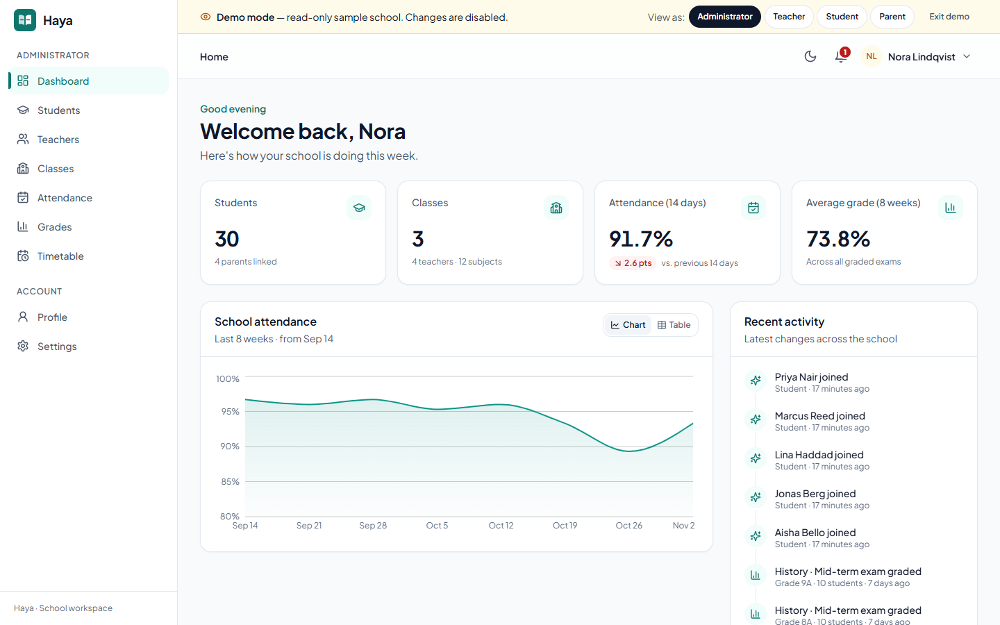
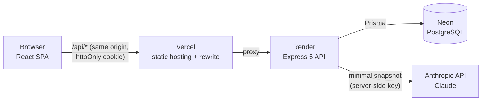

# Haya: school management

Haya is a full-stack school management app for administrators, teachers, students and
parents. It covers classes, enrollment, attendance registers, exams and gradebooks,
timetables and notifications, plus **Haya Insights**: AI-written progress summaries and
rule-based early-warning flags.

**Live demo:** https://manageschool-fawn.vercel.app. Pick a role on the sign-in page. There's
no sign-up needed, and demo accounts are read-only.



> The API runs on Render's free tier and sleeps when idle. The first request can take
> 30–60 seconds; the app shows a "waking up the server" notice while it waits.

## Features by role

| Role | What they can do |
| --- | --- |
| **Admin** | School-wide dashboard (attendance trend, class comparison, activity); manage students, teachers, parents and classes; create accounts; see every gradebook, register and timetable; at-risk overview |
| **Teacher** | Dashboard for their own classes (today's lessons, registers still to mark, upcoming exams); mark attendance; create exams and enter grades; view rosters and student profiles; at-risk students in their classes |
| **Student** | Own attendance, grades by subject, timetable, upcoming exams and an AI progress summary |
| **Parent** | The same for each of their children, with a child switcher |

Shared across roles: light and dark themes, adjustable text size, reduced-motion support,
keyboard navigation with a skip link, and layouts tested from 375 px phones to desktops.

## Haya Insights (AI)

Two features, both server-side, both labelled **"AI-generated · review before sharing"**.

**Students who may need support** (teachers and admins). A student is flagged by **plain
SQL rules, not by AI** ([`riskFlags.js`](school-backend/src/ai/riskFlags.js)):

- attendance below 85% in the last 21 days
- attendance down 10+ points against the five weeks before
- recent exam average down 8+ points against earlier exams
- recent exam average below 50%

"Explain" asks Claude to put the numbers that fired into two or three plain sentences, with
one gentle next step. The model never decides who is flagged.

**Progress summary** (on a student's profile and on the student and parent dashboards). A
short paragraph plus two or three concrete suggestions, streamed token by token. Teachers
can copy it as a draft report-card comment.

How it's built:

- **Minimal data.** The prompt gets a snapshot with a first name, class level, attendance
  figures, subject averages and recent results. No emails, ids, parent details or other
  students. Prompt templates are in [`src/ai/prompts/`](school-backend/src/ai/prompts).
- **Same access rules as the data.** Parents see their own children, teachers students in
  their classes, students themselves, admins everyone.
- **Cached.** Each result is stored with a hash of the prompt version, the model and the
  underlying data, so it's reused until grades or attendance actually change. Users can
  press "Regenerate" to get a fresh one.
- **Limits and failures.** 20 generations per user per hour. Typed errors (busy,
  unavailable, not configured, not enough data) become friendly messages in the UI.
- **Demo accounts cost nothing.** They get sample text built from the same numbers, which
  is never stored and never calls the API.
- Uses the official [`@anthropic-ai/sdk`](https://www.npmjs.com/package/@anthropic-ai/sdk),
  model `claude-opus-5-5` by default (override with `ANTHROPIC_MODEL`).

## Architecture



| Layer | Stack |
| --- | --- |
| Frontend | React 19, Vite 7, React Router, Redux Toolkit, Tailwind CSS 3, Recharts (`school-frontend/`) |
| Backend | Express 5, Prisma 6, PostgreSQL, zod, JWT in an httpOnly cookie, `@anthropic-ai/sdk` (`school-backend/`) |
| Tests | Vitest + Supertest against a real Postgres; Vitest + Testing Library; Playwright + axe UI review |
| CI | GitHub Actions: API tests with a Postgres service, then web lint, tests and build |

## Security decisions

- **Sessions in an httpOnly, SameSite=Lax cookie**, which JavaScript can't read, so an XSS
  bug can't steal the session. Vercel proxies `/api` so the cookie is first-party.
- **CSRF:** SameSite plus an Origin check on every state-changing request.
- **Authorization is central** ([`lib/access.js`](school-backend/src/lib/access.js)): every
  list and record is scoped to what the caller may see, not just checked by role.
- **Public sign-up is limited to students and parents.** Staff accounts are created by an
  admin.
- **Rate limits** on login (per IP and email), registration, demo sign-in and AI generation.
- **Read-only, sandboxed demo:** demo writes are blocked in the auth middleware, and demo
  sessions only see the seeded demo school.
- **Fail-fast config:** the server refuses to start without a 32+ character `JWT_SECRET`.

More detail: [docs/security.md](docs/security.md).

## Local setup

Prerequisites: Node 20+ and Docker (or any PostgreSQL 14+).

```bash
# 1. Database (Postgres on localhost:5433)
docker compose up -d

# 2. API
cd school-backend
cp .env.example .env              # set JWT_SECRET: openssl rand -hex 32
npm install
npx prisma migrate deploy
npm run db:seed                   # demo school + the four demo logins
npm run dev                       # http://localhost:5000

# 3. Web app (another terminal)
cd school-frontend
npm install
npm run dev                       # http://localhost:5173, /api proxied to :5000
```

Demo logins after seeding: `admin@demo.haya.app`, `teacher@demo.haya.app`,
`student@demo.haya.app` and `parent@demo.haya.app`. The password is `DEMO_PASSWORD` if
set, otherwise `HayaDemo#2026`. The one-click role buttons on the sign-in page use the
same accounts.

To create a real (non-demo) admin:
`npm run reset-admin-password -- --email you@example.com --password 'A-Strong#Passphrase1'`.

### Environment variables

**Backend (`school-backend/.env`, or Render → Environment):**

| Variable | Required | Description |
| --- | --- | --- |
| `DATABASE_URL` | yes | PostgreSQL connection string (Neon: the direct, non-pooler URL) |
| `JWT_SECRET` | yes | 32+ random characters; the server won't start without it |
| `NODE_ENV` | prod | `production` enables Secure cookies |
| `FRONTEND_URL` | prod | Allowed browser origin(s), comma-separated |
| `TRUST_PROXY` | prod | Proxies in front of the API: `2` for Vercel + Render |
| `ANTHROPIC_API_KEY` | for AI | Enables Haya Insights. Without it, real accounts see "not configured" |
| `ANTHROPIC_MODEL` | no | Defaults to `claude-opus-5-5` |
| `DEMO_PASSWORD` | no | Password for seeded demo accounts |
| `JWT_EXPIRES_IN` | no | Session length, default `7d` |

**Frontend:** none. The app calls `/api` on its own origin.

## Scripts

| Where | Command | What it does |
| --- | --- | --- |
| backend | `npm run dev` | API with auto-reload |
| backend | `npm test` | integration tests (uses the `haya_test` database; refuses any URL without "test") |
| backend | `npm run db:seed` | create or refresh the demo school (idempotent, touches demo data only) |
| backend | `npm run start:prod` | apply migrations (baselining a `db push` database once), then start. Used on Render |
| backend | `npm run reset-admin-password` | create or reset an admin |
| frontend | `npm run dev` / `build` / `lint` / `test` | dev server, production build, ESLint, unit tests |
| frontend | `npm run ui:review` | Playwright + axe pass over every page, role, theme and viewport |

## Documentation

- [docs/api.md](docs/api.md): endpoints, access rules, error format, streaming
- [docs/security.md](docs/security.md): sessions, CSRF, authorization, rate limits, demo, AI
- [docs/design-system.md](docs/design-system.md): tokens, components, accessibility checks
- [docs/deployment.md](docs/deployment.md): Render, Vercel and Neon setup, migrations, cold starts
